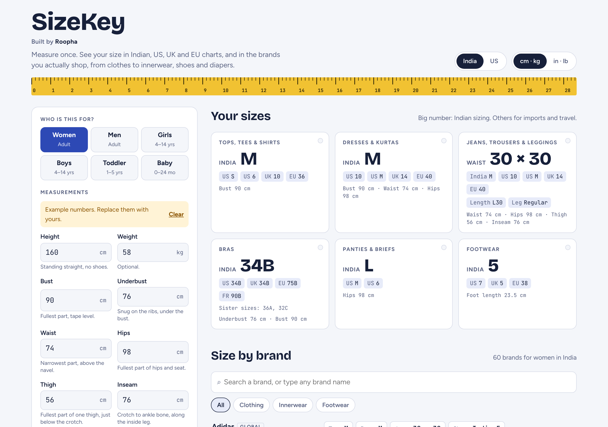
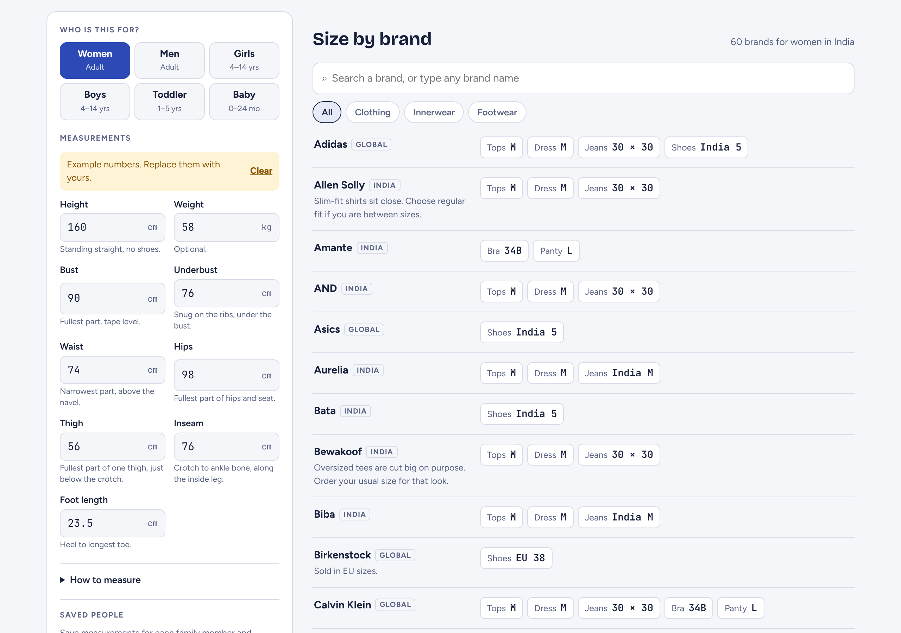
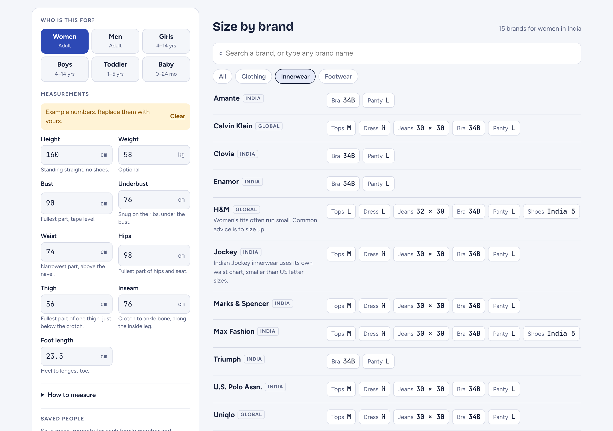
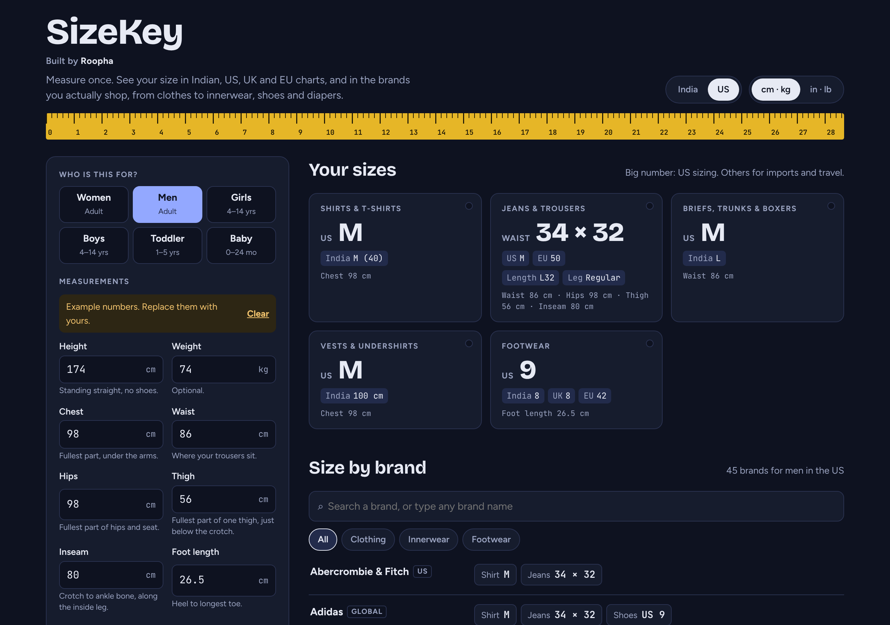
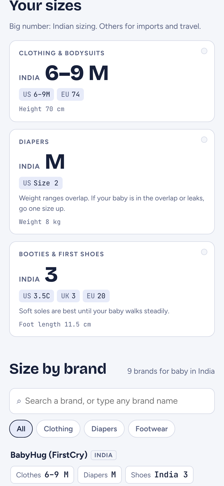
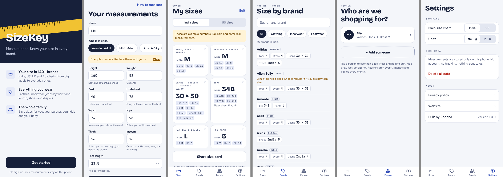

# SizeKey

**Measure once. Know your size in every brand.**

SizeKey turns your body measurements into the right size for clothing, innerwear, bras, footwear and diapers, in Indian, US, UK and EU charts and across 140+ brands.

## Why SizeKey exists

Finding your size is harder than it should be.

- **Every brand sizes differently.** A "Medium" at one brand is a "Large" at another. Some brands run small, some are cut roomy, and some use numbers instead of letters.
- **Every country sizes differently.** Indian, US, UK and EU charts use different numbers for the same body. Indian innerwear and vests often follow their own charts, so your US size doesn't carry over.
- **It's not just dresses.** Bras, briefs, vests, shoes, kids' clothes and diapers each have their own sizing system, so people end up guessing across many charts.
- **Families shop for many bodies.** Parents buy for themselves, their kids, a toddler and a baby who changes size every few months.
- **Wrong sizes cost time and money.** Online shoppers return clothes mostly because of fit, and every return means waiting, repacking and sometimes paying.
- **Size charts mostly cover big brands.** Everyday labels that most people actually buy rarely get the same attention.

SizeKey puts all of this in one place. You enter your measurements once and see your size everywhere, for everyone in the family, without signing up and without your data leaving your phone.

## What it covers

| | |
|---|---|
| **People** | Women, men, girls, boys, toddlers (1–5 yrs) and babies (0–24 months) |
| **Clothing** | Tops and shirts, dresses and kurtas, jeans and trousers (waist × length, with fit tips from hips and thighs), kids' clothing |
| **Innerwear** | Bras (band and cup, with sister sizes), panties, briefs and trunks, vests, kids' innerwear |
| **Footwear** | Adult, youth, child and baby sizes |
| **Diapers** | Diapers and pull-ups, sized by weight |
| **Charts** | India, US, UK and EU |
| **Brands** | 140+ Indian, US and global brands, from big names to everyday labels. Any brand not listed uses the standard chart. |

## Screenshots

**Size by brand.** Every brand shows your size for each thing it sells, with notes on brands that run small or large.

**Innerwear.** Filter brands by clothing, innerwear or footwear.

**Men, US sizing, dark mode.** Switch between India and US shopping, and between cm/kg and inches/lb.

**Baby, on a phone.** Clothing by height, diapers by weight and first shoes by foot length.

## Coming soon: the SizeKey app

An iPhone and Android app is in progress, with the same sizes as the website plus family profiles, re-measure reminders for kids and a shareable size card.

## Other features

- Save measurements for each family member and switch between them
- A note when you're right at the edge of a size
- Plain how-to-measure guidance for every field
- Works on phones, tablets and computers, in light and dark mode

## Privacy

SizeKey has no accounts, no server and no tracking. Measurements stay in the visitor's browser. See [PRIVACY.md](PRIVACY.md).

## Run it locally

SizeKey is a static website with no build step. Open `index.html` in a browser.

## Accuracy

Brand sizes are estimates from standard size charts and each brand's general fit, not each brand's official chart. Always check the size chart on the product page before buying.

## Roadmap

- Replace the estimates with each brand's published size chart, stored as data files
- Per-product fit (slim, regular, oversized)
- More measurements (neck, shoulder) for shirts
- More brands and countries

## License

Copyright © 2026 rroopha-25. All rights reserved. See [LICENSE](LICENSE).
